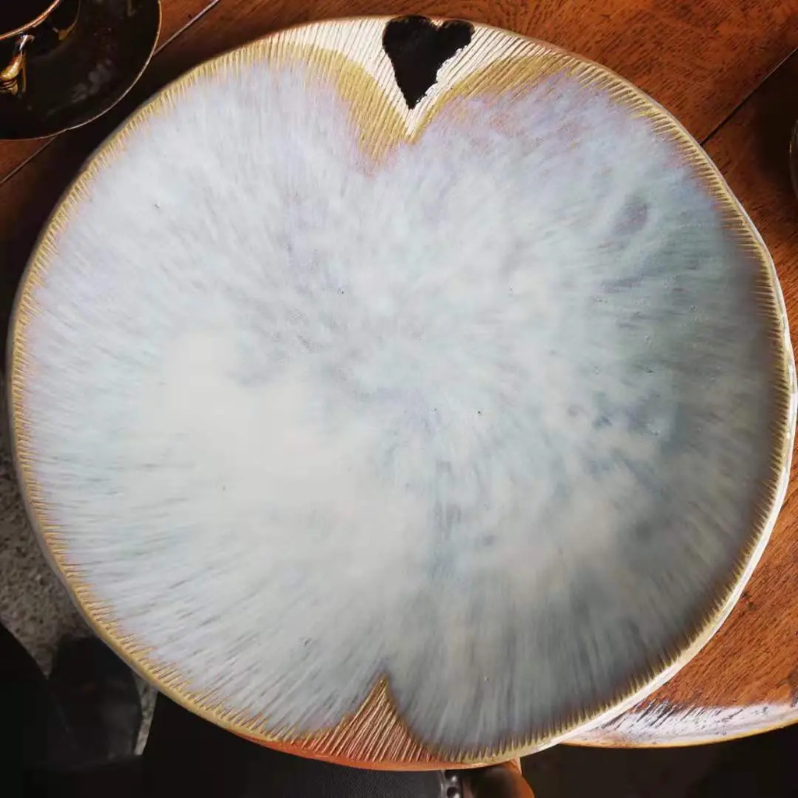

<a id="readme-top"></a>

<div align="center">
  <a href="https://github.com/v6582374-netizen/AoiPlate">
    
  </a>

  <h1 align="center">AoiPlate</h1>

  <p align="center">
    A macOS menu-bar todo app that brings your tasks onto a tactile, full-screen plate stage.
    <br />
    <br />
    <a href="https://github.com/v6582374-netizen/AoiPlate/releases"><strong>Download for macOS »</strong></a>
    <br />
    <br />
    <a href="https://github.com/v6582374-netizen/AoiPlate/releases">Releases</a>
    &middot;
    <a href="https://github.com/v6582374-netizen/AoiPlate/issues/new?labels=bug">Report a bug</a>
    &middot;
    <a href="https://github.com/v6582374-netizen/AoiPlate/issues/new?labels=enhancement">Request a feature</a>
  </p>

  [![Latest release][release-shield]][release-url]
  [![macOS 14+][macos-shield]][release-url]
  [![MIT License][license-shield]][license-url]
</div>

<details>
  <summary>Contents</summary>
  <ol>
    <li><a href="#about-the-project">About the project</a></li>
    <li><a href="#getting-started">Getting started</a></li>
    <li><a href="#usage">Usage</a></li>
    <li><a href="#data-and-permissions">Data and permissions</a></li>
    <li><a href="#development">Development</a></li>
    <li><a href="#roadmap">Roadmap</a></li>
    <li><a href="#contributing">Contributing</a></li>
    <li><a href="#license">License</a></li>
    <li><a href="#contact">Contact</a></li>
    <li><a href="#acknowledgments">Acknowledgments</a></li>
  </ol>
</details>

## About the project

<p align="center">
  
</p>

Most todo apps confine work to a list. AoiPlate keeps the list out of sight until you need it: double-press the trigger key from anywhere in macOS and a transparent stage opens over the desktop. Each task becomes a plate whose size reflects its age, so the work that has been waiting longest carries more visual weight.

- Open or dismiss the stage with a double press of `J` by default.
- Add, edit, complete, and delete tasks directly on the stage.
- Switch to a searchable list when you need a denser view.
- Run quietly from the menu bar and launch automatically at login.

### Built with

- [Rust][rust-url]
- [Tao][tao-url]
- [Wry][wry-url]
- [macOS Core Graphics][core-graphics-url]

<p align="right">(<a href="#readme-top">back to top</a>)</p>

## Getting started

### Prerequisites

- A Mac running macOS 14 or later.
- Permission to enable **Input Monitoring** and **Accessibility** for AoiPlate. These permissions let the app detect its global trigger and reliably show its stage.

### Installation

1. Download `AoiPlate.dmg` from the [latest release][release-url].
2. Open the DMG and drag `AoiPlate.app` into **Applications**.
3. Open **AoiPlate** from Applications. It appears in the menu bar.
4. When macOS asks, allow **Input Monitoring** and **Accessibility**. The menu-bar menu can open the relevant System Settings panes again if needed.

`AoiPlate.app.zip` is an equivalent app bundle. `AoiPlate-macos-arm64.tar.gz` contains the command-line binary and is not intended to be opened in Finder.

<p align="right">(<a href="#readme-top">back to top</a>)</p>

## Usage

| Action | How |
| --- | --- |
| Show or hide the stage | Double-press `J`, or choose **Show / Hide AoiPlate** from the menu bar. Press `Esc` or click the backdrop to dismiss it. |
| Add a task | Press `N`, enter text in the bottom input, then press `Enter` or select **Save**. |
| Complete a task | Hold `Cmd` and click its plate. It fades out and the remaining plates reflow. |
| Edit a task | Double-click its plate. Short text edits in place; longer text opens in an adjacent editor. Press `Enter` to save or `Esc` to cancel. |
| Delete a task | Right-click its plate. |
| Search tasks | Press `M` for list view, then use the search field to filter open tasks. Press `M` again to return to the plate stage. |

The app handles composition input from Chinese IMEs: `Enter` first confirms an active composition and only saves after composition has completed.

<p align="right">(<a href="#readme-top">back to top</a>)</p>

## Data and permissions

Your tasks and settings stay on the Mac, in `~/Library/Application Support/AoiPlate/`:

- `todos.json` — task data
- `config.json` — trigger key and application preferences
- `error.log` — diagnostic log

On first launch, AoiPlate migrates data from the previous `TodoLite` application directory when it exists.

If the global `J` shortcut does nothing, confirm that AoiPlate is still running in the menu bar and re-enable both Input Monitoring and Accessibility in System Settings.

<p align="right">(<a href="#readme-top">back to top</a>)</p>

## Development

### Prerequisites

- macOS 14 or later
- A current Rust toolchain with Cargo
- Xcode Command Line Tools

Clone and build the project:

```sh
git clone https://github.com/v6582374-netizen/AoiPlate.git
cd AoiPlate
cargo check
cargo build --release
```

Create the macOS app bundle:

```sh
cargo bundle --release
```

Build all release assets, including the DMG, app ZIP, ARM64 archive, and SHA-256 checksums:

```sh
./scripts/build_release_assets_macos.sh
```

Artifacts are written to `dist/`.

<p align="right">(<a href="#readme-top">back to top</a>)</p>

## Roadmap

See the [open issues][issues-url] for proposed work and known problems.

<p align="right">(<a href="#readme-top">back to top</a>)</p>

## Contributing

Contributions are welcome. Please open an issue first for substantial changes so the interaction model stays coherent.

1. Fork the repository.
2. Create a feature branch: `git checkout -b feature/your-change`.
3. Make and verify your change with `cargo check`.
4. Commit, push, and open a pull request.

<p align="right">(<a href="#readme-top">back to top</a>)</p>

## License

Distributed under the [MIT License][license-url]. See [LICENSE](LICENSE) for details.

<p align="right">(<a href="#readme-top">back to top</a>)</p>

## Contact

Project home: [github.com/v6582374-netizen/AoiPlate](https://github.com/v6582374-netizen/AoiPlate)

<p align="right">(<a href="#readme-top">back to top</a>)</p>

## Acknowledgments

- [othneildrew/Best-README-Template](https://github.com/othneildrew/Best-README-Template) for the README structure.
- [Choose an Open Source License](https://choosealicense.com)
- [Shields.io](https://shields.io)

<p align="right">(<a href="#readme-top">back to top</a>)</p>

<!-- Markdown reference links -->
[release-shield]: https://img.shields.io/github/v/release/v6582374-netizen/AoiPlate?style=for-the-badge&label=release
[release-url]: https://github.com/v6582374-netizen/AoiPlate/releases/latest
[macos-shield]: https://img.shields.io/badge/macOS-14%2B-000000?style=for-the-badge&logo=apple&logoColor=white
[license-shield]: https://img.shields.io/badge/license-MIT-2ea44f?style=for-the-badge
[license-url]: https://github.com/v6582374-netizen/AoiPlate/blob/main/LICENSE
[issues-url]: https://github.com/v6582374-netizen/AoiPlate/issues
[rust-url]: https://www.rust-lang.org/
[tao-url]: https://github.com/tauri-apps/tao
[wry-url]: https://github.com/tauri-apps/wry
[core-graphics-url]: https://developer.apple.com/documentation/coregraphics
